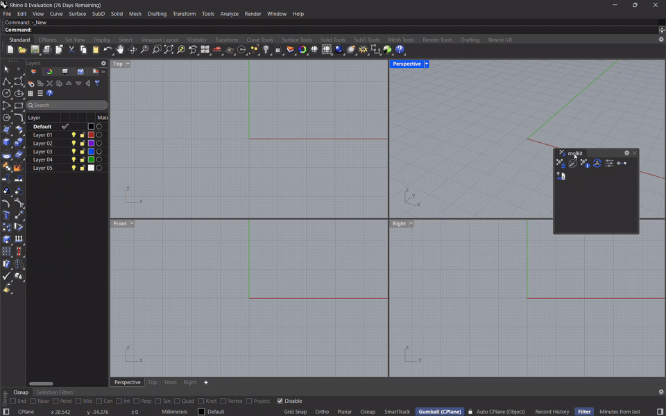
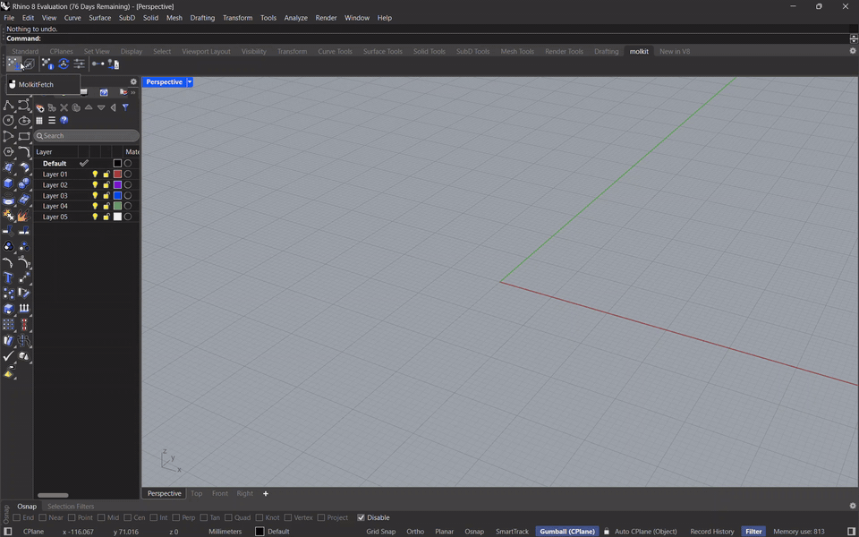
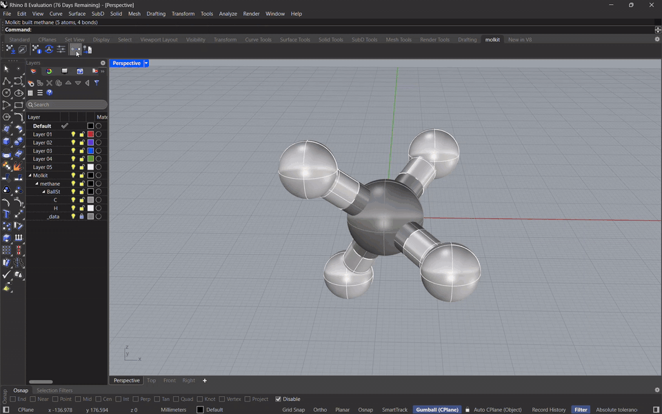

# molkit: print your own molecule puzzle

molkit turns any molecule into a **3D-printable puzzle**. Every atom becomes one piece, and the
pieces click together with pegs, just like the real atoms are bonded. The shape of each peg even
tells you what kind of bond it is.

You type a molecule's name, for example `caffeine`, and molkit:

1. downloads the molecule's real 3D shape from [PubChem](https://pubchem.ncbi.nlm.nih.gov/), a
   free chemistry database,
2. shows it as a ball-and-stick model,
3. cuts it into puzzle pieces, one per atom,
4. saves every piece as a file you can send to a 3D printer.

No coding or 3D-design experience is needed. The steps below cover installation, a first
puzzle, printing and assembly.

> **This is an early version (0.1.2-beta).** The pieces have not been test-printed yet, so the
> pegs may come out a little too tight or too loose on your printer.
> [Changing the fit](#the-pegs-are-too-tight-or-too-loose) takes one setting.

---

## Contents

1. [What you need](#what-you-need)
2. [Step 1: Install Rhino 8](#step-1-install-rhino-8)
3. [Step 2: Install molkit](#step-2-install-molkit)
4. [Step 3: Make your first puzzle](#step-3-make-your-first-puzzle)
5. [Step 4: Print and assemble](#step-4-print-and-assemble)
6. [More things you can do](#more-things-you-can-do)
7. [All commands](#all-commands)
8. [Troubleshooting](#troubleshooting)

---

## What you need

- **A Windows computer.** molkit is made for Windows. It may work on a Mac, but that has not
  been tested.
- **Rhino 8.** molkit runs inside it (see below).
- **An internet connection**, to download molecules.
- **A 3D printer**, or access to one. Many libraries, schools and "makerspaces" have printers
  you can use, and online printing services can print the files and post them to you.

### What is Rhino 8?

[Rhino](https://www.rhino3d.com/) (full name *Rhinoceros*) is a program for designing 3D
objects. Designers, architects and jewellers use it. molkit is a **plugin**: an add-on that gives
Rhino new abilities, in this case building molecule puzzles. molkit does the design work; this
guide lists the commands to type.

Rhino is paid software, but you can **try it free for 90 days** with every feature working, which
is plenty to make puzzles. Students and teachers can buy it at a large discount.

---

## Step 1: Install Rhino 8

1. Go to the Rhino download page: <https://www.rhino3d.com/download/>
2. Choose **Rhino 8** for **Windows** and **Download** the free evaluation (trial). You will be
   asked for an email address, where the license key is sent.
3. Open the downloaded file and follow the installer, keeping all the default choices.
4. Start Rhino once and enter your email and license key when asked, so it is ready to use.
5. **Close Rhino** before the next step.

---

## Step 2: Install molkit

### 2a. Download molkit

1. Open the molkit download page: <https://github.com/galigna/rhino-molkit/releases>
2. Under the newest version, open **Assets** and click the file whose name ends in **`.yak`**
   (for example `molkit-0.1.2-beta+287-rh8-any.yak`).
3. Your browser saves it to your **Downloads** folder, where the install command looks for it.

### 2b. Install it with one command

Rhino installs plugins with a small helper program, started by pasting **one line** into
**PowerShell**, a window for typing commands to Windows.

1. Make sure **Rhino is closed**.
2. Click the Windows **Start** button, type **`PowerShell`**, and click **Windows PowerShell**.
   A dark blue or black window opens.
3. Copy this whole line (or use the copy button in the corner of the box):

   ```powershell
   & "C:\Program Files\Rhino 8\System\Yak.exe" install (Get-ChildItem "$env:USERPROFILE\Downloads\molkit-*.yak" | Sort-Object LastWriteTime | Select-Object -Last 1).FullName
   ```

   *What it does:* it finds the newest molkit file in your Downloads folder and hands it to
   Rhino's plugin installer (`Yak.exe`).

4. Click inside the PowerShell window, **right-click** (or press **Ctrl+V**) to paste the line,
   and press **Enter**.
5. After a few seconds you should see a message that molkit was installed. You can close the
   PowerShell window.

If an error appears instead, see [Troubleshooting](#troubleshooting).

### 2c. Open Rhino

Start Rhino. Rhino first shows a window with **templates** (starting points for a new file).
Choose **Small Objects - Millimeters**. molkit works in millimetres, like 3D printers do.

Press the triangle button next to the Perspective view, and choose the Shaded version.
Double click on the Perspective view to go fullscreen.


The **first** time you use a molkit command, it downloads some free chemistry tools it needs
(about 40 MB). This takes a minute and happens only once. If it stops with a *timed out*
message on a slow connection, run the same command again.

---

## Step 3: Make your first puzzle

Rhino is controlled by typing **commands**. At the top of the Rhino window is a line that says
**`Command:`**. Typed text appears there, and **Enter** runs the command.

**The molkit buttons.** The first time you open Rhino after installing molkit, a small window
with molkit's buttons appears. Drag it by its title to the top of the Rhino window, next to the
other buttons, and it stays there from then on. Each button does the same as typing the command
(hold the mouse over a button to see its name). If the window is closed, the commands can still
be typed.



The first example is **methane**, the simplest molecule: one carbon atom with four hydrogens.

1. Type **`MolkitFetch`** and press **Enter**.
2. When it asks for a name, type **`methane`** and press **Enter**.
   A grey ball (carbon) with four white balls (hydrogen) appears. To look around:
   - **drag with the right mouse button** in the view labelled *Perspective* to turn the model,
   - **scroll the mouse wheel** to zoom.

   

3. Type **`MolkitPuzzle`**, press **Enter**, then **click the model**.
   The ball-and-stick model turns into five puzzle pieces. (Want the ball-and-stick model back?
   Type **`MolkitRegenerate`** and click a piece.)

   

---

## Step 4: Print and assemble

### Save the pieces

1. Type **`MolkitExportStl`**, press **Enter**, and **click the model**.
2. Choose an empty folder, for example a new folder called *methane puzzle*.

molkit saves one file per piece:

```
methane_000_C.stl    ← the carbon piece
methane_001_H.stl    ← a hydrogen piece
methane_002_H.stl
methane_003_H.stl
methane_004_H.stl
methane_manifest.json
```

The letters at the end tell you which atom each piece is (**C** = carbon, **H** = hydrogen,
**O** = oxygen, **N** = nitrogen, and so on). `methane_manifest.json` is a text list of which piece
connects to which, useful during assembly; Notepad opens it.

### Print

`.stl` files are the standard format for 3D printing. Open them in your printer's **slicer**
program, the software that prepares files for your printer (for example *PrusaSlicer*,
*UltiMaker Cura* or *Bambu Studio*, all free), and print them like any other model. If you use a
printing service, upload the `.stl` files.

### Assemble

Push each peg into a hole. The peg shapes match the bonds of the real molecule:

| Peg shape | Bond | How it behaves |
|---|---|---|
| Round | single bond | the piece can spin, just like a real single bond |
| One flat side (D shape) | double bond | locks in place, fits only one way |
| Two flat sides | aromatic bond (in rings like benzene) | locks in place, fits two ways |
| Round and thicker | triple bond | goes straight through |

Hydrogen pieces always have pegs; heavier atoms, like carbon, have the holes.

---

## More things you can do

### Build other molecules

Use `MolkitFetch` with any molecule's **English name**, for example `water`, `ethanol`,
`caffeine`, `aspirin` or `glucose`. Every atom is one piece: methane has 5 pieces, caffeine 24.

Very large molecules (more than about 50 atoms besides hydrogens) still work. PubChem has no 3D
shape for them, so molkit calculates one, which takes a few seconds.

### Leave out the hydrogens

Hydrogens make up many of the pieces. To leave them out: type **`MolkitSettings`**, press
**Enter**, click the model, click **IncludeHydrogens** so it says **No**, then press **Enter**.

### Make the pieces bigger or smaller

In `MolkitSettings`, click **Scale** and type a new number. The default is **20** (a carbon ball
about 17 mm across); **30** makes everything 1.5 times bigger.

### Use a resin printer

In `MolkitSettings`, click **Resin**. This switches to smaller, finer pieces with tighter pegs,
suited to resin printers.

### Open a crystal structure file (CIF)

Scientists publish measured molecule structures as **CIF files**, for example in the free
[Crystallography Open Database](https://www.crystallography.net/). Download a `.cif` file, type
**`MolkitImportCif`** in Rhino, and choose the file. molkit takes one complete molecule out of
the crystal and builds it like any other.

---

## All commands

| Command | What it does |
|---|---|
| `MolkitFetch` | Builds a molecule from its name. |
| `MolkitImportCif` | Builds a molecule from a crystal structure file (`.cif`). |
| `MolkitPuzzle` | Turns the ball-and-stick model into puzzle pieces. |
| `MolkitExportStl` | Saves the pieces as files for 3D printing. |
| `MolkitSettings` | Changes sizes, the peg fit, hydrogens on or off, or switches between the FDM and Resin presets. |
| `MolkitInfo` | Shows facts about a molecule: its formula, its bonds and the current settings. Press **F2** to see the full text. |
| `MolkitRegenerate` | Turns puzzle pieces back into the ball-and-stick model, or repairs a model after you deleted parts of it by accident. |

---

## Troubleshooting

### PowerShell shows an error when installing

- An error that mentions a missing file or argument: the `.yak` file is not in your **Downloads**
  folder, or its name doesn't start with `molkit-`. Move or rename it, then paste the line again.
- *"…Yak.exe…is not recognized…"*: Rhino 8 is not installed in the usual place. Check that Step 1
  finished, or replace `C:\Program Files\Rhino 8` in the command with Rhino's actual folder.

### Rhino says "Unknown command: MolkitFetch"

molkit is not installed, or Rhino was open while you installed it. Close Rhino, do
[Step 2b](#2b-install-it-with-one-command) again, then start Rhino.

### "PubChem has no compound named …"

Check the spelling, or try another common name of the molecule (for example `vitamin C` or
`ascorbic acid`).

### "timed out" or "could not reach PubChem"

Your internet was too slow or briefly offline. Wait a moment and run the command again.

### "no pieces built"

molkit found that some pieces would print badly, for example walls that are too thin. The lines
above the message say what is wrong. Usually the cause is a setting that was changed: open
`MolkitSettings` and click **FDM** (or **Resin**) to go back to the standard sizes.

### The pegs are too tight or too loose

Every printer is a little different. Type `MolkitSettings`, click the model, click
**Clearance**, and type a new number, then press **Enter** and export again:

- pegs **too tight**: make it bigger, for example `0.3` (the default is `0.2`),
- pegs **too loose**: make it smaller, for example `0.15`.

### The puzzle won't close around a ring

Molecules with rings, like benzene, are hard to finish: the last piece of a ring has to bend a
little to fit. This is a known limitation of this early version.

### Still stuck?

[Open an issue](https://github.com/galigna/rhino-molkit/issues) on GitHub with the steps taken and
the message Rhino showed.

---

## For developers

How molkit works inside, how to run its tests and how to build the plugin:
[docs/development.md](docs/development.md).

## License

molkit is free and open source under the [MIT License](LICENSE).
