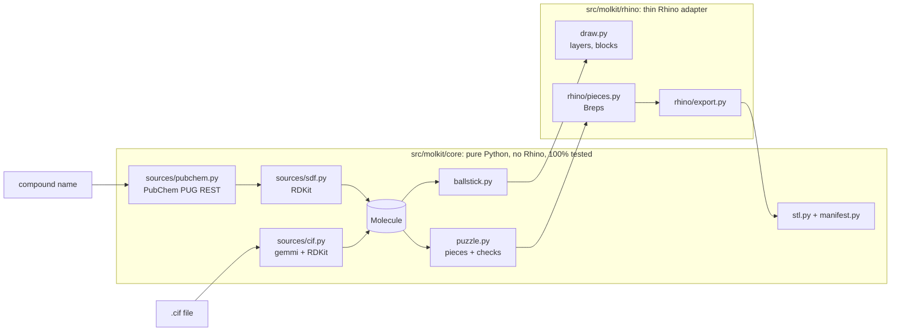

# molkit

A Rhino 8 plugin that turns molecules into 3D-printable puzzles: one piece per atom, joined by
pegs whose shape encodes the bond order.

Type a compound name (fetched from PubChem) or open a crystal structure (CIF), and molkit builds
an accurate ball-and-stick model, splits it into printable pieces and exports one STL per piece
with assembly instructions.

> **Status: v0.1.0, early.** Every command works, but the peg and clearance sizes have not been
> test-printed yet ([docs/print-tests.md](docs/print-tests.md)). Expect to adjust `Clearance`
> for your printer.

## How the puzzle works

Each atom is a ball with half-bonds attached. Neighbouring pieces meet at the middle of each bond,
where one half carries a peg and the other a hole:

- **The heavier atom gets the hole**, so hydrogens and halogens always carry pegs. In a bond
  between equal atoms (C–C), the lower-numbered atom gets the hole.
- **The peg shape follows how the bond rotates:**

  | Bond | Peg | Behaviour |
  |---|---|---|
  | Single | round | spins freely, like a real single bond |
  | Double | one flat (D shape) | locked, fits one way: the bond is planar |
  | Aromatic | two flats | locked, fits two ways (180° apart) |
  | Triple | round, thicker | linear, so rotation doesn't matter |

- **Flats face the π orbital**, perpendicular to the plane of the molecule, so the locked pieces
  assemble in the real geometry.
- **Holes are enlarged by a clearance** (0.2 mm for FDM), and pegs have a chamfered tip.

Before building, molkit checks the pieces can be printed: walls around holes, joints inside
balls, overlapping balls, holes reaching past the ball centre. Problems are listed instead of
building broken pieces.

## Commands

| Command | Does |
|---|---|
| `MolkitFetch` | Fetches a compound from PubChem by name and builds a ball-and-stick model. PubChem has 3D structures only for molecules up to 50 heavy atoms; for larger ones RDKit generates the coordinates. Option `Kekulize` shows aromatic rings as alternating single and double bonds. |
| `MolkitImportCif` | Opens a CIF file of a molecular crystal, applies the crystal symmetry and builds one whole molecule, even if the file cuts it at the cell edge. Polymers and frameworks are rejected. |
| `MolkitInfo` | Click any part of a model to print its formula, bonds, source and parameters (F2 shows the full output). |
| `MolkitSettings` | Edit a model's parameters (scale, hydrogens, peg sizes, clearance, …) or apply the `FDM` / `Resin` preset, then rebuild. |
| `MolkitPuzzle` | Splits a model into printable pieces, one per atom. |
| `MolkitExportStl` | Writes one STL per piece (in mm) and a `<name>_manifest.json` saying which piece joins which. |
| `MolkitRegenerate` | Rebuilds a model from its stored data, e.g. after deleting parts by hand. |

A typical session: `MolkitFetch methane` → `MolkitPuzzle` → `MolkitExportStl` → slice and print
→ assemble using the manifest.

Models are **regenerated from data stored on the model** (a locked anchor point on the `_data`
layer), not edited by hand. Changing a setting rebuilds the model and its pieces.

## Installing

1. Download the `.yak` file from the
   [GitHub releases](https://github.com/galigna/rhino-molkit/releases).
2. In a Windows terminal, install it with Rhino's package manager (use the file name you
   downloaded):
   ```
   "C:\Program Files\Rhino 8\System\Yak.exe" install molkit-0.1.0-rh8-any.yak
   ```
3. Restart Rhino and type `MolkitFetch`.

The first command installs RDKit and gemmi into Rhino's Python (about 40 MB). Rhino's installer
times out after 15 s, so on a slow connection the first attempt may fail. Just run it again.

Requires Rhino 8 on Windows. macOS should work (the packages ship Mac wheels) but is untested.

## Parameters

`MolkitSettings` exposes every parameter. The presets:

| Parameter | FDM (default) | Resin |
|---|---|---|
| Scale (mm per Å) | 20 | 12 |
| Ball radius (× van der Waals radius) | 0.25 | 0.25 |
| Stick radius | 3.5 mm | 2.2 mm |
| Peg radius / triple-bond peg radius | 1.75 / 2.1 mm | 1.1 / 1.35 mm |
| Flat depth | 0.6 mm | 0.4 mm |
| Peg length / extra hole depth | 5.0 / 0.4 mm | 3.5 / 0.3 mm |
| Clearance (radial) | 0.2 mm | 0.1 mm |
| Chamfer | 0.3 mm | 0.2 mm |
| Minimum wall | 1.0 mm | 0.6 mm |

Applying a preset keeps your hydrogens setting.

## Limitations

- **Rings may not close.** Every joint is a straight push-fit along its bond, so the last bond
  of a ring only goes in if the plastic flexes. Small rings are hardest.
- **Untested print sizes.** See the status note above.
- **Molecular crystals only.** CIF import extracts one discrete molecule; extended structures
  (MOFs, silicates, metals) are rejected.
- **Metals.** The element table covers organic elements, halogens, common counter-ions and the
  metals with Bondi van der Waals radii (Ni, Cu, Zn, Pd, Ag, Pt, Au, Hg, …), but not Fe, Co,
  Mn or Cr. Bonds around metals are always single.
- **Generated coordinates** (large PubChem compounds) are one plausible shape, not a measured
  structure.
- **New models are drawn at the world origin**, so two models overlap. You can move one away,
  but regenerating puts it back at the origin.

## Architecture



- **`src/molkit/core/`** holds every chemistry and geometry decision: reading PubChem and CIF,
  the molecule model, ball-and-stick layout, puzzle rules, printability checks, STL bytes and
  the manifest. It never imports Rhino; a test enforces that.
- **`src/molkit/rhino/`** turns core's specs into Rhino objects and handles user input. It makes
  no decisions of its own.
- **`rhino/commands/`** holds each command's three-line entry script.

See [SPEC.md](SPEC.md) for the full design and [CLAUDE.md](CLAUDE.md) for the coding rules.

## Development

```bash
uv sync                         # Python 3.9 (Rhino 8's version) with the pinned rdkit/gemmi
uv run pytest --cov=molkit.core # core must stay at 100% line and branch coverage
uv run ruff check . && uv run mypy
```

Requires [uv](https://docs.astral.sh/uv/). CI runs the same checks on every pull request.

The Rhino side can't run in CI: [docs/smoke-test.md](docs/smoke-test.md) is the manual checklist,
including how to run the commands straight from a checkout. Building the plugin is described in
[docs/packaging.md](docs/packaging.md).

## License

[MIT](LICENSE)
