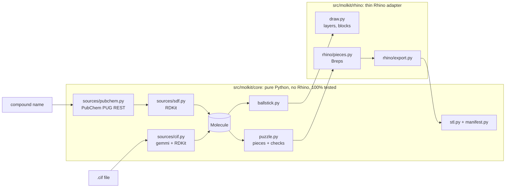

# Developing molkit

This page is for people who want to change molkit's code. To *use* molkit, see the
[README](../README.md).

## How the puzzle works

Each atom is a ball with half-bonds attached. Neighbouring pieces meet at the middle of each bond,
where one half carries a peg and the other a hole:

- **The heavier atom gets the hole**, so hydrogens and halogens always carry pegs. Between equal
  atoms (C–C), the lower-numbered atom gets the hole.
- **The peg shape follows how the bond rotates:**

  | Bond | Peg | Behaviour |
  |---|---|---|
  | Single | round | spins freely, like a real single bond |
  | Double | one flat (D shape) | locked, fits one way: the bond is planar |
  | Aromatic | two flats | locked, fits two ways (180° apart) |
  | Triple | round, thicker | linear, so rotation doesn't matter |

- **Flats face the π orbital**, perpendicular to the plane of the molecule, so locked pieces
  assemble in the real geometry.
- **Holes are enlarged by a clearance**, and pegs have a chamfered tip.
- Before building, `puzzle.check` rejects thin walls around holes, joints inside balls,
  overlapping balls and holes reaching past the ball centre.

## Architecture



- **`src/molkit/core/`** holds every chemistry and geometry decision: reading PubChem and CIF,
  the molecule model, ball-and-stick layout, puzzle rules, printability checks, STL bytes and
  the manifest. It never imports Rhino; a test enforces that.
- **`src/molkit/rhino/`** turns core's specs into Rhino objects and handles user input. It makes
  no decisions of its own.
- **`rhino/commands/`** holds each command's three-line entry script; `rhino/molkit.rhproj` is
  the Script Editor project that packages everything as a plugin.

See [SPEC.md](../SPEC.md) for the full design and [CLAUDE.md](../CLAUDE.md) for the coding rules.

## Running the checks

```bash
uv sync                         # Python 3.9 (Rhino 8's version) with the pinned rdkit/gemmi
uv run pytest --cov=molkit.core # core must stay at 100% line and branch coverage
uv run ruff check . && uv run mypy
```

Requires [uv](https://docs.astral.sh/uv/). CI runs the same checks on every pull request.

The Rhino side can't run in CI: [smoke-test.md](smoke-test.md) is the manual checklist, including
how to run the commands straight from a checkout. Building and releasing the plugin is described
in [packaging.md](packaging.md).
